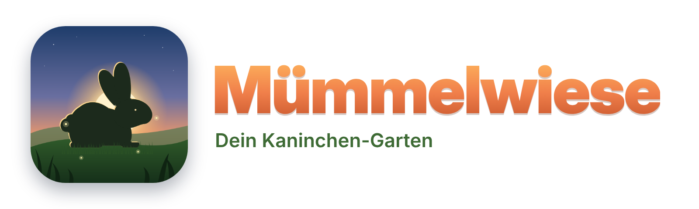
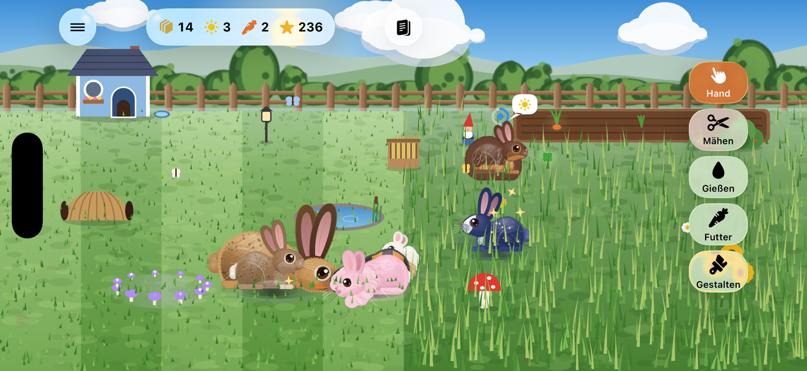
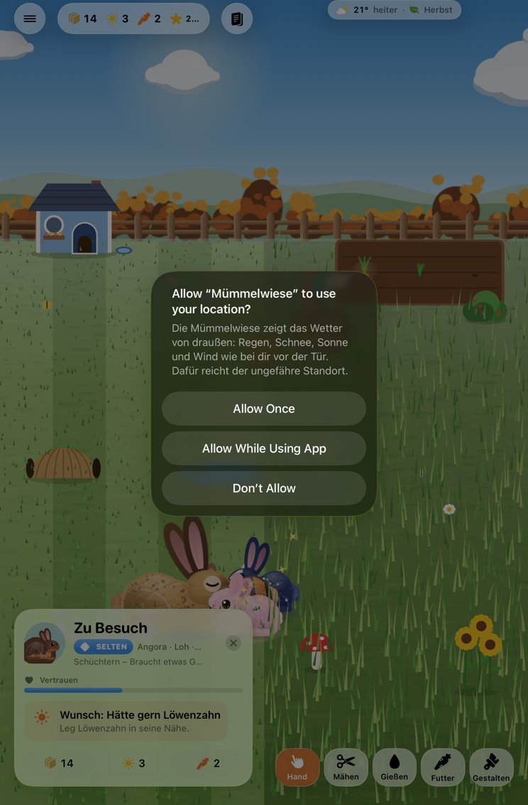

<p align="center"></p>

# Mümmelwiese






Eigenständiges Kaninchen-Spiel (SwiftUI, iOS 26) – eine Art Tamagotchi auf einer lebendigen Wiese.

## Öffnen & starten

1. `Muemmelwiese/Muemmelwiese.xcodeproj` in Xcode 26 öffnen.
2. Unter *Signing & Capabilities* dein Team wählen.
3. Auf iPhone oder Simulator starten.

## Spielprinzip

- **Besuch:** Kaninchen hoppeln zufällig herein. Futter und vorsichtiges Streicheln schaffen Vertrauen – bei vollem Kreis ziehen sie ein.
- **Seltenheit:** gewöhnlich · selten · super selten · legendär. Seltene haben besondere Fellfarben, Zeichnungen und Rassen, sind scheuer und bleiben kürzer – bringen aber mehr Sterne. Legendäre (Sternenstaub, Mondschein, Kirschblüte, Nachthimmel) leuchten und glitzern.
- **Pflege:** Satt, Laune, Energie und Freundschaft. Langer Rasen ist Futter, gemäht wird er zu Heu, im Beet wachsen Möhren, Löwenzahn wird gepflückt.
- **Sterne & Shop:** Glückliche Kaninchen sammeln Sterne. Dafür gibt es Deko (Teich, Weidentunnel, Heuraufe, Laterne, Feenring …) und größere Zuhause (Holzstall → Blaues Häuschen → Pilzhaus → Hasenschloss) mit mehr Platz.
- **Gestalten:** Deko aufstellen, verschieben, einpacken. Gemütlichkeit erhöht die Chance auf seltene Gäste.
- **Tag & Nacht** folgen der echten Uhr; Regen, Glühwürmchen, Schmetterlinge. Niemand verhungert – der Garten bleibt sanft.

## Faltbares iPhone

- **Zugeklappt (Außendisplay):** Einhand-Bedienung, Werkzeuge unten im Daumenbereich.
- **Aufgeklappt (Innendisplay, 4:3):** Bedienung in zwei gleich breiten Hälften – links Menü, Vorrat und Karten,
  rechts Wetter, Hinweise und Werkzeuge. Der Spalt dazwischen liegt genau auf dem Falz; die Wiese läuft über die ganze Breite.
- **Querformat:** Werkzeuge senkrecht am rechten Rand.
- Erkennung über das Seitenverhältnis der verfügbaren Fläche (wie in Floof), Spielstand und Auswahl bleiben beim Auf- und Zuklappen erhalten.

## Wetter, Jahreszeiten, Mitteilungen

- Wetter von draußen über Open-Meteo (ungefährer Standort, kein Konto): Wolken, Regen, Schnee, Gewitter, Nebel, Wind, Temperatur, Sonnenauf- und -untergang.
- Jahreszeiten nach Datum: im Winter kaum Gras – Heu und Apfelzweige füttern. Zu Beginn jedes Winters gibt es einen geschenkten Vorrat (Heu, Zweige, Möhren, Heuraufe); sind Heu und Zweige leer, hilft einmal am Tag die Nachbarin aus.
- Lokale Mitteilung, wenn ein super seltener oder legendärer Gast auftaucht, während die App zu ist.

## Aufbau

```
Muemmelwiese/
├─ App/    Einstiegspunkt
└─ Game/   Modelle, Simulation (GardenGame), Zeichnung (GardenRenderer), Oberfläche (GardenView)
```

Alles wird mit `Canvas` gezeichnet – keine Bilddateien außer dem App-Icon.
Spielstand liegt in den UserDefaults (`muemmelwiese.save.v1`).

Screenshots: Workflow *Screenshots* (zusammen mit Floof) (Demo-Start mit `-MuemmelDemo YES -MuemmelScreen day|night|shop|album`).
