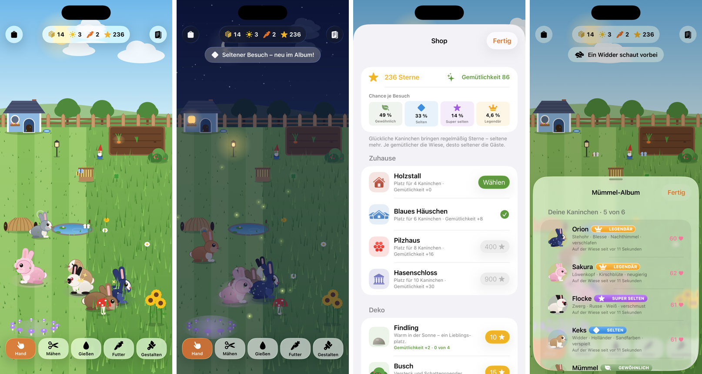

# Mümmelwiese



Eigenständiges Kaninchen-Spiel (SwiftUI, iOS 26) – eine Art Tamagotchi auf einer lebendigen Wiese.

## Öffnen & starten

1. `Muemmelwiese/Muemmelwiese.xcodeproj` in Xcode 26 öffnen.
2. Unter *Signing & Capabilities* dein Team wählen.
3. Auf iPhone oder Simulator starten.

## Spielprinzip

- **Besuch:** Kaninchen hoppeln zufällig herein. Futter und vorsichtiges Streicheln schaffen Vertrauen – bei vollem Kreis ziehen sie ein.
- **Seltenheit:** gewöhnlich · selten · super selten · legendär. Seltene haben besondere Fellfarben, Zeichnungen und Rassen, sind scheuer und bleiben kürzer – bringen aber mehr Sterne. Legendäre (Sternenstaub, Mondschein, Kirschblüte, Nachthimmel) leuchten und glitzern.
- **Pflege:** Satt, Laune, Energie und Freundschaft. Langer Rasen ist Futter, gemäht wird er zu Heu, im Beet wachsen Möhren, Löwenzahn wird gepflückt.
- **Sterne & Shop:** Glückliche Kaninchen sammeln Sterne. Dafür gibt es Deko (Teich, Weidentunnel, Heuraufe, Laterne, Feenring …) und größere Zuhause (Holzstall → Blaues Häuschen → Pilzhaus → Hasenschloss) mit mehr Platz.
- **Gestalten:** Deko aufstellen, verschieben, einpacken. Gemütlichkeit erhöht die Chance auf seltene Gäste.
- **Tag & Nacht** folgen der echten Uhr; Regen, Glühwürmchen, Schmetterlinge. Niemand verhungert – der Garten bleibt sanft.

## Aufbau

```
Muemmelwiese/
├─ App/    Einstiegspunkt
└─ Game/   Modelle, Simulation (GardenGame), Zeichnung (GardenRenderer), Oberfläche (GardenView)
```

Alles wird mit `Canvas` gezeichnet – keine Bilddateien außer dem App-Icon.
Spielstand liegt in den UserDefaults (`muemmelwiese.save.v1`).

Screenshots: Workflow *Screenshots* (zusammen mit Floof) (Demo-Start mit `-MuemmelDemo YES -MuemmelScreen day|night|shop|album`).
